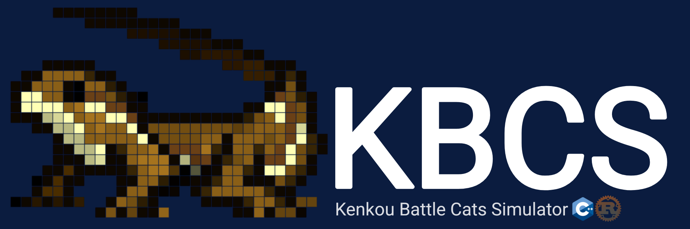

# KBCS

JAR評価：満点の作品 
分類：[永遠の書庫塔](https://github.com/JarJarBlink/KBCS/tree/main/research/comparisons/arm64-v8a)（永恆書庫之塔 / Tower of the Eternal Archive）

KBCS（Kenkou Battle Cats Simulator）は、『にゃんこ大戦争』日本版の戦闘を正確に再現することを目指す、Windows・macOS向けのシミュレーターです。

  

## 目次

- [KBCSについて](#kbcsについて)
- [JAR評価・紹介](#jar評価紹介)
  - [原作メカニズムレベルのシミュレーションエンジン](#原作メカニズムレベルのシミュレーションエンジン)
- [できること](#できること)
  - [編成・戦闘シミュレーション](#編成戦闘シミュレーション)
  - [キャラ・敵キャラのデータ](#キャラ敵キャラのデータ)
  - [ステージデータ](#ステージデータ)
  - [モーションビューア](#モーションビューア)
- [ダウンロード](#ダウンロード)
- [最低動作環境](#最低動作環境)
- [推奨動作環境](#推奨動作環境)
- [インストール手順](#インストール手順)
- [初回データ取得・更新](#初回データ取得更新)
- [はじめての使い方](#はじめての使い方)
- [対応範囲と開発状況](#対応範囲と開発状況)
- [よくある質問](#よくある質問)
- [開発とクレジット](#開発とクレジット)
- [ライセンス](#ライセンス)

## KBCSについて

出撃できるタイミング、命中時の処理、波動の進行などをゲーム本編の挙動と照合しながら開発しています。照合条件や結果を記録しています。[戦闘の検証記録](native/kbcs-core/docs/battle-runtime.md)

キャラや敵の能力、ステージで敵が出現する条件を確認し、同じステージで編成やアイテムを変えながら戦い方を試せます。

## JAR評価・紹介

### 原作メカニズムレベルのシミュレーションエンジン

世間一般のサードパーティ製シミュレーターを超える再現度を備え、迅速かつ継続的なイテレーション開発を通じて、『にゃんこ大戦争』原作のゲームメカニズムを精密に再現しています。

本シミュレーターは、他のサードパーティ製ソフトウェアや既存のシミュレーションフレームワークの上に構築されたものではなく、原作ゲームそのものを直接の研究対象とし、低レイヤーのメカニズムから独自に開発されています。疑似C++コードおよびネイティブコードの徹底的な解析を通じて、原作の実際の動作ロジックを段階的に再構築しています。

開発および検証の過程では、専門家による研究グループを通じて技術交流、クロスディスカッション、および結果の検証を行い、シミュレーションのメカニズムが原作に可能な限り近づくよう徹底しています。

未確認のメカニズムについては「保留および空値（未設定）とする原則」を採用しており、主観的な推測や信頼性の低い近似アルゴリズム、未検証の仮定によって未知の部分を補うことはしません。

さらに、本シミュレーターが構築する高精度なシミュレーション能力と完全なデータチェーンは、AI学習環境に向けた確かな技術的基盤となります。信頼性が高く追跡可能（トレーサブル）なゲームメカニズムのデータにより、AIが原作の実際の動作条件により近い環境で学習、テスト、および戦略検証を行えるようになります。

**私たちが追求しているのは、見た目上似ているだけのシミュレーション結果ではなく、原作のプログラムロジックと実際のメカニズムに基づく高精度な再現であり、それを将来のAI知能学習および自動化研究における中核的基盤とすることです。**

## できること

### 編成・戦闘シミュレーション

- **編成の作成と保存**。10枠のキャラを選び、形態、レベル、本能、本能玉、にゃんこ砲などを設定できます。発動するにゃんコンボを確認し、用途別に編成を保存できます。
- **既存ステージへの出撃**。ホームの「ステージ Play」から「既存マップから」を選び、ステージ、冠、編成、アイテムを選んで出撃できます。出撃前に敵一覧や出撃制限も確認できます。
- **戦闘の観察と録画**。戦闘の一時停止、速度変更、1Fまたは10F単位でのコマ送りができます。敵・味方の体力や行動状態を確認でき、戦闘を動画として保存できます。録画で選べる動画形式は動作環境によって異なります。

### キャラ・敵キャラのデータ

- **キャラデータ**。レア度、属性、特性などで絞り込み、体力、攻撃力、DPS、射程などを比較できます。形態やレベルを変え、本能を適用した数値や成長グラフ、入手・進化条件を確認できます。検索結果はCSVで保存できます。
- **敵キャラデータ**。属性や特性などで絞り込み、敵倍率やクリスタルのお宝を設定したときの体力・攻撃力などを確認できます。ステージ詳細からは、そのステージでの倍率を引き継いで敵の詳細を開けます。

### ステージデータ

- マップやステージを検索して、出現する敵とその出現条件、冠ごとの倍率、出撃制限、固定編成、XPや報酬などを確認できます。
- 対応するステージでは、背景や城のプレビューとBGMの試聴ができます。

### モーションビューア

- 味方・敵キャラやエフェクトのモーションを再生し、フレームを進めて動きを確認できます。
- キャラのパーツや分割画像を確認し、見たいパーツだけを表示したり、画像をPNGで保存したりできます。

## ダウンロード

### インストールファイル

| 使用する端末 | ZIPのファイル名 |
| --- | --- |
| Windows 64ビット | `KBCS-<バージョン>-windows-x64.zip` |
| Mac・Mシリーズ | `KBCS-<バージョン>-macos-arm64.zip` |
| Mac・Intel | `KBCS-<バージョン>-macos-x64.zip` |

[リリースページ](https://github.com/sinsuirakv0/KBCS/releases)の **Assets** から、自分の端末用ZIPがある最新のKBCS版をダウンロードします。OSごとにビルドが成功し次第公開するため、最新リリースに対応ZIPがない場合は一つ前以降のリリースを確認してください。アプリ内の更新も、端末に対応した最新版を案内します。

## 最低動作環境

Windows欄のCPU・メモリ・GPUは、普段の利用で動作を確認しているPCを基準にした目安です。このPCはSATA SSDを使用しています。

| 項目 | Windows | Mac |
| --- | --- | --- |
| OS | Windows 11・64ビット（x64） | macOS 14以降 |
| CPU | x64対応。Intel Core i5-8350U（4コア・8スレッド）を目安 | Apple Silicon（arm64）またはIntel（x64） |
| メモリ | 8 GBを目安 | 下限は未計測 |
| グラフィックス | WebGL 2.0が使えること。Intel UHD Graphics 620で動作実績あり | WebGL 2.0が使えること |
| ストレージ | データ保存先の空き5 GBを目安 | データ保存先の空き5 GBを目安 |
| 実行環境 | Microsoft Edge WebView2 Runtime（Evergreen） | OS付属のWebKit |
| インターネット接続 | 初回データ取得・更新時に必要 | 初回データ取得・更新時に必要 |

## 推奨動作環境

戦闘の高速再生や録画、ほかのアプリとの同時利用を想定した目安です。

| 項目 | Windows | Mac |
| --- | --- | --- |
| CPU | Core i5-8350Uと同程度以上 | Apple Silicon（Mシリーズ）またはIntel（x64） |
| メモリ | 16 GB以上 | 16 GB以上 |
| グラフィックス | WebGL 2.0対応でGPUアクセラレーションが使える環境 | WebGL 2.0対応でGPUアクセラレーションが使える環境 |
| ストレージ | SSD・データ保存先の空き10 GB以上 | SSD・データ保存先の空き10 GB以上 |

更新や録画に必要な空き容量は、取得するデータや録画形式によって変わります。

## インストール手順

### Windows

1. [Releases](https://github.com/sinsuirakv0/KBCS/releases)でWindows用ZIPがある最新のKBCS版から、`KBCS-<バージョン>-windows-x64.zip`をダウンロードします。
2. ZIPを右クリックし、**「すべて展開」**を選びます。`kbcs.exe`とDLLファイルは同じフォルダーに置きます。
3. WebView2 Runtimeが未導入の場合は、[Microsoft公式配布ページ](https://developer.microsoft.com/ja-jp/microsoft-edge/webview2/)から**「エバーグリーン ブートストラップ」**をダウンロードして実行します。
4. 展開先の**`kbcs.exe`**をダブルクリックして起動します。初回起動時にデスクトップへショートカットを追加します。再作成はホームの**「設定 → KBCSシステム情報 → デスクトップに追加」**から行えます。

### Mac

1. Appleメニューの**「このMacについて」**を開き、チップの種類を確認します。
2. [Releases](https://github.com/sinsuirakv0/KBCS/releases)で自分のMac用ZIPがある最新のKBCS版から、Mシリーズは`KBCS-<バージョン>-macos-arm64.zip`、Intelは`KBCS-<バージョン>-macos-x64.zip`をダウンロードします。
3. ZIPを展開し、**`KBCS.app`**を自分のホーム内の**`Applications`**フォルダーへ移動します。フォルダーがなければFinderで作成してください。
4. 移動した**`KBCS.app`**をダブルクリックして起動します。初回起動時にデスクトップへ起動用リンクを追加します。追加できなかった場合は、移動先のアプリからホームの**「設定 → KBCSシステム情報 → デスクトップに追加」**を実行します。
5. 現在のMac用自動ビルドは開発用署名です。開発元を確認できないと表示された場合は、配布元を確認し、**「システム設定」→「プライバシーとセキュリティ」→「このまま開く」**から起動します。[Appleの案内](https://support.apple.com/ja-jp/102445)

### 最新の自動ビルドを使う場合

[Actions](https://github.com/sinsuirakv0/KBCS/actions/workflows/build.yml)の最新の**「Build Windows and macOS」**を開き、自分の端末のbuildジョブが成功していれば、Artifactsから`KBCS-windows-x64`・`KBCS-macos-arm64`・`KBCS-macos-x64`をダウンロードできます。他のOSの失敗により実行全体が赤くなっていても、成功した端末の成果物を利用できます。ArtifactsのダウンロードにはGitHubへのログインが必要です。外側のZIPを展開し、中の`KBCS-<バージョン>-<端末>.zip`を上記の手順で展開します。

## 初回データ取得・更新

初回起動時は必要なデータを自動取得します。取得が完了するまで待ってください。失敗した場合はホームの**「設定 → データ管理」**（旧版は「データ管理」）から再試行できます。

データ・編成・設定は、Windowsでは`%LOCALAPPDATA%\KBCS`、Macでは`~/Library/Application Support/KBCS`へ保存されます。本体を入れ替えても同じ場所のデータを引き継ぎます。新しい本体・データの公開時は起動時に通知します。後回しにした更新は、ホームの**「設定 → データ管理」**（旧版は「データ管理」）から実行できます。

## はじめての使い方

1. KBCSを起動し、初回のデータ取得が完了するまで待ちます。
2. ホームの「ステージ Play」→「編成」でキャラを選びます。編集内容は自動で保存されます。
3. 「ステージ Play」→「既存マップから」でマップとステージを選びます。出撃準備で編成、冠、アイテムを確認し、「いざ出陣!!」を押します。
4. 戦闘中はキャラを出撃させて遊べます。動きを詳しく見たいときは、操作盤の「一時停止」や「1F ▶」を使えます。

## 対応範囲と開発状況

- **対象データ**は『にゃんこ大戦争』の日本版です。導入済みのデータ版はKBCSのホームで確認できます。
- **出撃先**は収録された既存マップです。自作マップの編集や出撃は今後の対応項目です。
- **開発版を配布中**。一部の特殊ステージの進行や演出は、引き続き実装・照合を進めています。[GitHub Releases](https://github.com/sinsuirakv0/KBCS/releases)

## よくある質問

### 初回のデータ取得に失敗したら？

インターネット接続と保存先の空き容量を確認し、「設定 → データ管理 → データ取得・更新」から再試行できます。

### 自分の端末用のZIPが見つからないときは？

[ダウンロード](#ダウンロード)の表でファイル名を確認し、リリースをさかのぼって対応するZIPを探してください。

### オフラインでも使えますか？

取得済みのデータはオフラインで閲覧できます。初回のデータ取得や更新にはインターネット接続が必要です。

## 開発とクレジット

- 開発・メンテナンス [健康おじ（@sinsuirakv0）](https://github.com/sinsuirakv0)
- コード生成には生成AIを使用しています。[OpenAI Codex（@codex）](https://github.com/codex)

## ライセンス

KBCSの作者が権利を持つソースコードや、そのコードを含むビルドを再配布する場合は、事前に作者の許可を得てください。改変版の再配布も対象です。

公開リポジトリの閲覧とGitHub上でのフォークには、GitHubの利用規約が適用されます。[GitHub利用規約](https://docs.github.com/en/site-policy/github-terms/github-terms-of-service#5-license-grant-to-other-users)

第三者が権利を持つ画像・音声・データには、各権利者の利用条件が適用されます。

同梱している第三者ライブラリとフォントのライセンスは、それぞれの文書を参照してください。

- [html2canvas](ui/vendor/html2canvas.LICENSE)
- [Notoフォント](ui/fonts/noto-fonts-NOTICE.txt)
- [Robotoフォント](ui/fonts/roboto-fonts-NOTICE.txt)
